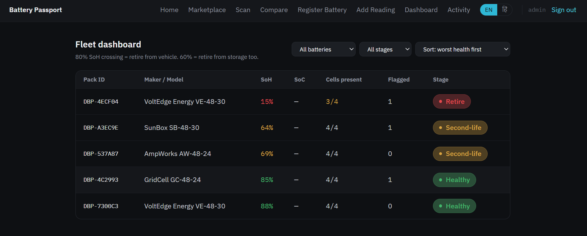
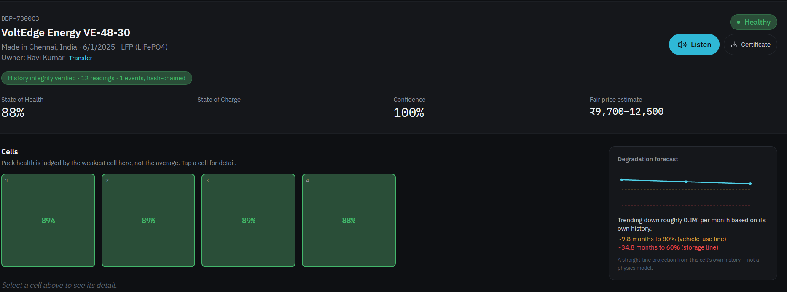
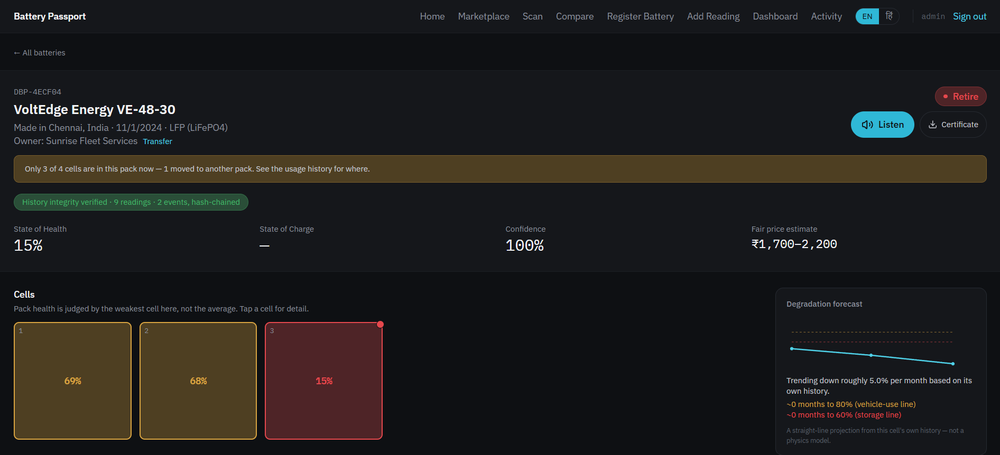
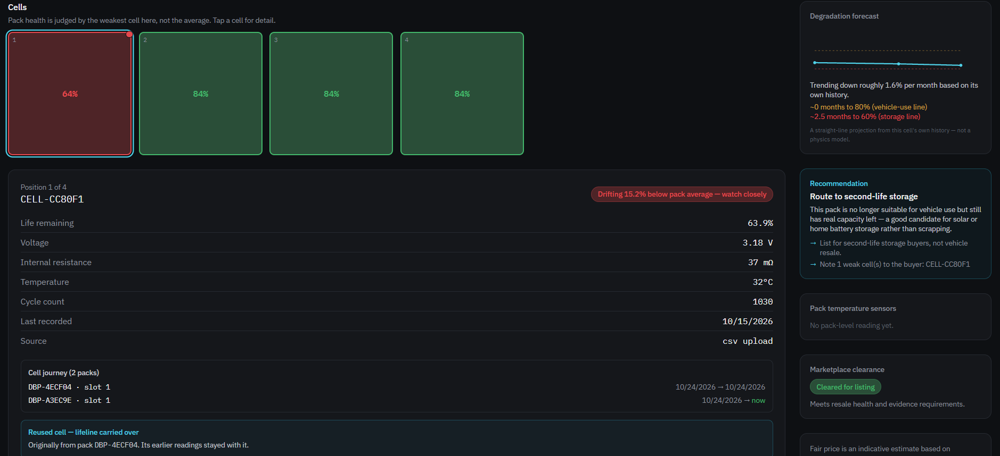
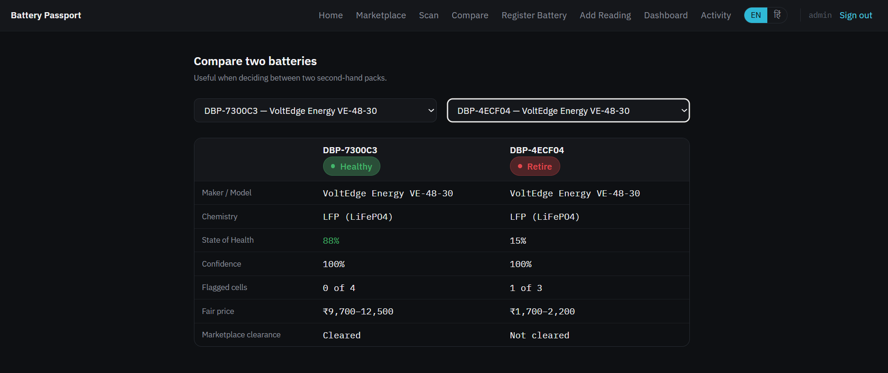
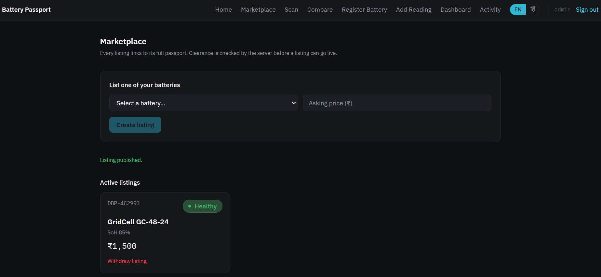

# 🔋 Digital Battery Passport

**A QR-code passport for second-hand EV and e-rickshaw batteries: health tracked cell by cell, with a history that can't be quietly rewritten.**

[](https://battery-passport-eight.vercel.app)


**Live demo:** https://battery-passport-eight.vercel.app

---

## Screenshots

| Fleet dashboard | Passport (healthy pack) |
|---|---|
|  |  |

| Passport (retire pack, flagged cell) | Cell journey (reused cell) |
|---|---|
|  |  |

| Compare two packs | Marketplace clearance |
|---|---|
|  |  |

---

## The problem

The battery is one of the most valuable parts of a used EV, yet a buyer has no reliable way to check its real condition. Sellers can hide how a pack was used, dashboards can be reset, and a pack with an "85% healthy" average can still hide a nearly dead cell that fails months later. Fleet owners face the same blind guessing when deciding which pack to repair, reuse or retire.

## The idea

Every battery gets a permanent record behind a QR code. Anyone can scan it, with no app and no login, and see who made it, how it has been used, how healthy it is **cell by cell**, and what to do with it next. Technicians add readings; the record can only grow, and any attempt to edit the past is detectable.

## Key features

**For buyers (public, no login)**
- Passport page opened from a QR code: State of Health and State of Charge shown separately, a tappable per-cell grid, evidence confidence score, indicative price band
- Pack health is judged by the **weakest cell**, not the average
- Degradation forecast, and a recommendation: continue, repair, second-life storage, or recycle
- A "History integrity verified" check that re-computes the record's hash chain
- Cell journey: a cell reused in another pack keeps its full history, and the old pack's timeline records that it left
- Honest labels: retro-registered batteries say plainly that earlier usage wasn't recorded
- Compare two packs side by side
- Printable certificate, English/Hindi interface, and a "Listen" button that reads the summary aloud (browser text-to-speech)

**For technicians (approved accounts)**
- Register a battery with an atomic server call, including cells reused from packs you registered; local QR label generation
- Add readings: manual cell entry, pack state of charge + 6 temperature sensors, and **CSV import** that auto-matches column names (e.g. "Voltage (V)", "IR", "Cycles", "Cell #"), accepts cells by ID or position, supports dated history, and validates every row before saving
- Read a **JBD / Xiaoxiang smart-BMS over Bluetooth** (experimental), plus a clearly labelled simulation mode
- Fleet dashboard, activity log with automatic "cell crossed the replace line" events, ownership transfer, marketplace listing

**For admins**
- Approve new technician accounts from the Activity page

## How health is calculated

These are transparent heuristics, not a battery-physics simulation.

| Item | Rule |
|---|---|
| Cell health | `100 − cycle wear − resistance penalty`. Cycle wear = cycles ÷ rated cycle life (LFP 3000, NMC 1200, LTO 6000, other 1500). Resistance penalty = `(mΩ − 30) ÷ 4` when above 30 mΩ |
| Pack health | The **weakest cell** |
| Stage | ≥ 80% healthy · 60–80% second-life · < 60% retire |
| Cell flag | ≤ 20% life, or ≥ 6 points below the pack average |
| Evidence confidence | How recent and how many readings back each cell |
| Marketplace clearance | Not "retire" **and** evidence ≥ 30% |
| Price band | Indicative only: new-pack price per kWh × health, ±; not live market data |
| Forecast | Straight-line trend through the weakest cell's own readings |

The same clearance rule is implemented in the database (`battery_clearance`) and in the browser, so the server, not the page, decides whether a listing is allowed.

Full formulas and worked rules: **[docs/HOW_IT_WORKS.md](./docs/HOW_IT_WORKS.md)**

## Architecture

```
Browser (React + TypeScript, Vite)
   │  public reads · signed-in writes
   ▼
Supabase
 ├─ PostgreSQL ── tables, row-level security, triggers, server functions (RPC)
 ├─ Auth ──────── email + password, admin approval of new accounts
 └─ Storage ───── battery photos (JPEG/PNG/WebP, ≤ 5 MB)
```

Sensitive operations are single server functions, so they are all-or-nothing and can't be skipped by calling the API directly:
`register_battery`, `transfer_ownership`, `create_listing`, `withdraw_listing`, `approve_technician`, plus read-only `battery_clearance` and `verify_battery_integrity`.

## Data integrity and security model

- **Reads are public** (a passport is meant to be checked by anyone). **Writes need an admin-approved technician account**; the first account created becomes admin.
- **Append-only history.** Readings, usage events, flag events and pack readings cannot be updated or deleted, enforced by database triggers and not only by the UI.
- **Hash-chained records.** Each reading (per cell) and each usage event (per pack) stores the SHA-256 hash of its content plus the previous record's hash. `verify_battery_integrity` recomputes the chain and reports any edit or gap.
- **Rules enforced in the database:** cycle counts can't decrease, readings can't be dated in the future or before the previous reading, readings must be recorded against the pack the cell currently belongs to, and values must be in plausible ranges.
- **Cell reuse** is only allowed from packs you registered (admins: any), and not from a pack with an active listing.
- **Honest limits:** this is *tamper-evident*, not tamper-proof. Edits and deletions in the middle of a history are detected; deleting only the newest record is not, without anchoring hashes outside the database. The database owner could disable triggers, which the integrity check would then reveal.

## Tech stack

| Layer | Tools |
|---|---|
| Frontend | React 19, TypeScript, Vite, React Router, Tailwind CSS 4 |
| Backend | Supabase (PostgreSQL, Auth, Storage, Row-Level Security, PL/pgSQL functions) |
| QR | `qrcode` (generation, fully local), `jsQR` (decoding), browser camera / image upload |
| Data import | PapaParse (CSV) |
| Hardware | Web Bluetooth API (JBD BMS adapter), Web Speech API (text-to-speech) |
| UI | lucide-react icons, IBM Plex fonts |
| Hosting | Vercel |

## Project structure

```
├── src/
│   ├── lib/            data access, health calculations, auth, CSV import,
│   │                   QR helpers, Bluetooth + BMS adapter (bms/jbd.ts), i18n, speech
│   ├── components/     passport widgets, approval gate, Bluetooth panel, nav
│   ├── pages/          Home, Passport, Register, AddReading, Dashboard,
│   │                   Marketplace, Compare, Scan, ActivityLog, Login
│   └── data/           built-in demo data (used only when Supabase isn't configured)
├── supabase/           schema.sql and migrations (run in the Supabase SQL Editor)
├── demo/               sample CSV files for a full walkthrough
├── docs/               health logic, CSV format, testing guides and screenshots
├── vercel.json         single-page-app rewrite (needed so QR links like /p/DBP-… work)
└── .env.example
```

## Getting started

**Prerequisites:** Node.js 18+, and a free [Supabase](https://supabase.com) project.

1. **Clone and install**
   ```bash
   git clone https://github.com/Grecia1225/IND-EV-Batterypassport.git
   cd IND-EV-Batterypassport
   npm install
   ```
2. **Create the database.** In Supabase → *SQL Editor*, run `supabase/schema.sql`, then `supabase/migration_03_hardening.sql` (it also includes everything from `migration_02.sql`). It is safe to re-run.
3. **For a quick demo,** turn off email confirmation: Supabase → *Authentication → Sign In / Providers → User Signups → Confirm email*.
4. **Configure environment.** Copy `.env.example` to `.env`:
   ```
   VITE_SUPABASE_URL=https://<your-project>.supabase.co
   VITE_SUPABASE_ANON_KEY=<your publishable / anon key>
   VITE_PUBLIC_BASE_URL=https://<your-deployed-site>   # optional; used in printed QR labels
   ```
   The publishable key is designed to be public. Never put a `service_role` / secret key in this app.
5. **Run**
   ```bash
   npm run dev      # http://localhost:5173
   npm run build    # production build
   ```
6. **Create the admin account.** Sign up on the Login page; the **first** account becomes admin. Later sign-ups wait for approval under *Activity*.

Without Supabase credentials the app still opens, showing built-in demo data.

## Deploying (Vercel)

1. Import the repository in Vercel (framework preset: Vite).
2. Add the environment variables above (`VITE_SUPABASE_URL`, `VITE_SUPABASE_ANON_KEY`, and after the first deploy `VITE_PUBLIC_BASE_URL`), then redeploy.
3. `vercel.json` rewrites all paths to `index.html`, so direct links such as `/p/DBP-7F3A9C` (what a QR code opens) work.
4. Register batteries *after* deploying so printed QR labels carry the public address.

Camera scanning and Bluetooth need HTTPS (or localhost); Vercel provides HTTPS.

## Try it with sample data

The `demo/` folder contains five CSV files that produce five different passports (healthy, drift/repair, second-life, retire, and a retro-registered pack that reuses a cell). Register a pack, open *Add Reading*, choose the pack, and import the matching file in the CSV box at the bottom. Cells are matched by position, so the files work with any pack of four cells. Register pack E **last**, so the cell it reuses from pack B already has history.

| File | Shows |
|---|---|
| `A_healthy_pack.csv` | Healthy pack, dated history, forecast |
| `B_retire_pack.csv` | One failing cell makes the whole pack "retire"; automatic flag event |
| `C_drift_repair_pack.csv` | Healthy pack with one drifting cell → "repair candidate" |
| `D_second_life_pack.csv` | NMC pack in the second-life band |
| `E_retro_reuse_pack.csv` | Retro-registered pack reusing a cell from pack B |

Step-by-step test plan: **[docs/TESTING.md](./docs/TESTING.md)**

## CSV format

Headers are matched automatically (case, spaces and units ignored). Required: a cell identifier (ID or position), voltage, cycle count. Optional: resistance, temperature, date.

```csv
cell_id,voltage_v,resistance_mohm,temperature_c,cycle_count,recorded_at
```

Dates may be `YYYY-MM-DD` or `DD/MM/YYYY`. Rows are validated before saving, and the database has the final say. All accepted header names and limits: **[docs/CSV_FORMAT.md](./docs/CSV_FORMAT.md)**

## Limitations (stated plainly)

- **Real BMS data needs manufacturer cooperation.** Each BMS family uses its own protocol. One adapter (JBD / Xiaoxiang) is implemented and has been tested against protocol sample frames, not yet against a physical board. Other brands need their own adapter.
- **Data is only as good as who enters it** until a live BMS feed exists. Readings from CSV or manual entry carry that source label.
- **Prices are indicative**, not market quotes; the forecast is a straight-line projection.
- **Hindi translation covers the original labels;** newer screens are English only. Hindi speech quality depends on the voices installed on the device.
- Practice data can't be deleted from the app (by design); a database owner can reset a demo database in the SQL Editor.

## Roadmap

More BMS adapters · anchoring record hashes outside the database · crowdsourced real-sale pricing · a calibrated degradation model · full Hindi coverage · automated test suite and CI · pagination for very large fleets.

## Author

Built by [@Grecia1225](https://github.com/Grecia1225).

## License

Licensed under the Apache License 2.0. See the [LICENSE](./LICENSE) file for details.
