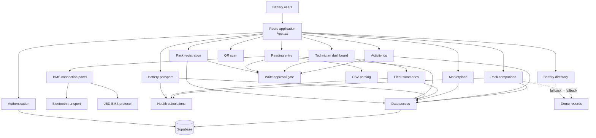

# 🔋 IND-EV Battery Passport

> A digital battery lifecycle record and health assessment app for EV battery packs in India.

[](https://battery-passport-eight.vercel.app)


**Live demo:** https://battery-passport-eight.vercel.app

---

## 📖 Overview

Battery Passport gives every EV battery pack a traceable digital identity. Technicians register a pack and log cell readings manually, by CSV upload, or directly from a supported Bluetooth BMS. Anyone can then open a pack's **passport** to see its health, provenance and usage history, compare packs side by side, scan a QR code, or browse resale listings.

It is built to support second-life decisions (keep in the vehicle, repair, reuse for storage, resell or recycle) with transparent, data-backed battery health instead of guesswork.

## ✨ Features

- **Battery passport**: per-pack page with health, confidence score, degradation forecast and a routing recommendation
- **Pack registration**: register new packs, each with a shareable QR code
- **Flexible reading entry**: manual form, CSV import, or live Bluetooth BMS capture
- **Smart CSV import**: flexible column names, every row validated before saving ([format guide](./docs/CSV_FORMAT.md))
- **Bluetooth BMS support**: connects over Web Bluetooth and decodes the JBD BMS protocol
- **Transparent health scoring**: cell and pack State of Health, life stage and flags ([how it works](./docs/HOW_IT_WORKS.md))
- **Technician dashboard**: fleet-level summaries across all registered packs
- **Battery directory**: browse and search all packs
- **Pack comparison**: compare packs side by side
- **Marketplace**: resale listings with an indicative fair price band and a health clearance check
- **QR scanning**: scan a pack's QR code to open its passport
- **Activity log**: audit trail of changes
- **Write approval gate**: write actions are restricted to approved users
- **Demo data fallback**: the app runs on sample records when no backend is configured

## 🔎 Battery Health at a Glance

| Pack State of Health | Stage | What it means |
|---|---|---|
| 80% or more | **Healthy** | Continue in vehicle use |
| 60% to under 80% | **Second-life** | Route to stationary storage (solar, home battery) |
| Under 60% | **Retire** | Route to recycling |

Pack health is judged by its **weakest cell**, not the average. Each cell's score comes from its cycle count (against the expected life of its chemistry) and its internal resistance. A **confidence score** shows how complete and recent the evidence is. Full details: [docs/HOW_IT_WORKS.md](./docs/HOW_IT_WORKS.md).

## 🧱 Tech Stack

| Layer | Technology |
|---|---|
| Frontend | React 19, TypeScript, React Router 7 |
| Build tool | Vite 8 |
| Styling | Tailwind CSS 4, Lucide icons |
| Backend / Auth / DB | Supabase (`@supabase/supabase-js`) |
| Data import | PapaParse (CSV) |
| QR | `qrcode` (generate), `jsQR` (scan) |
| Hardware | Web Bluetooth API (JBD BMS protocol) |
| Hosting | Vercel |

## 🧭 App Pages

| Route | Page |
|---|---|
| `/` | Battery directory |
| `/p/:id` | Battery passport |
| `/register` | Register a new pack |
| `/add-reading` | Add readings (manual, CSV, Bluetooth) |
| `/dashboard` | Technician dashboard |
| `/marketplace` | Resale marketplace |
| `/compare` | Compare packs |
| `/scan` | Scan a QR code |
| `/activity` | Activity log |
| `/login` | Sign in |

## 🏗️ Architecture



## 🚀 Getting Started

### Prerequisites

- Node.js 18+ and npm
- A [Supabase](https://supabase.com) project (optional, the app runs on demo data without one)
- A Chromium-based browser (Chrome, Edge) if you want to use Bluetooth BMS capture

### Installation

```bash
git clone https://github.com/Grecia1225/IND-EV-Batterypassport.git
cd IND-EV-Batterypassport
npm install
```

### Environment variables

```bash
cp .env.example .env
```

```env
VITE_SUPABASE_URL=your-supabase-project-url
VITE_SUPABASE_ANON_KEY=your-supabase-anon-key
```

If these are not set, the app still loads and falls back to demo data. Backend calls fail gracefully until real credentials are added.

> ⚠️ Never commit your real `.env` file. Only the anon (public) key belongs in the frontend.

### Database

Run the SQL files from the [`supabase/`](./supabase) folder in your Supabase project (SQL editor or Supabase CLI) to create the tables and server-side checks.

### Run locally

```bash
npm run dev
```

### Production build

```bash
npm run build
npm run preview
```

## 📡 Adding Readings

| Method | How |
|---|---|
| Manual | Fill in the form on the *Add Reading* page |
| CSV | Upload a file on the *Add Reading* page. See the [CSV format guide](./docs/CSV_FORMAT.md) and the [sample file](./docs/sample-readings.csv) |
| Bluetooth BMS | Connect a supported JBD BMS from the *Add Reading* page and save the live data |

> Bluetooth requires HTTPS (or `localhost`) and a browser with Web Bluetooth support.

## ☁️ Deployment

The project is configured for [Vercel](https://vercel.com) (see `vercel.json`):

1. Import the repo into Vercel
2. Add the two `VITE_SUPABASE_*` environment variables
3. Deploy

## 📚 Documentation

- [How the health assessment works](./docs/HOW_IT_WORKS.md)
- [CSV import format](./docs/CSV_FORMAT.md)
- [Sample readings file](./docs/sample-readings.csv)

## 🗺️ Roadmap

- [ ] Support for more BMS protocols beyond JBD
- [ ] Exportable PDF passport
- [ ] Automated tests and CI

## 🤝 Contributing

Contributions, issues and feature requests are welcome. Fork the repo, create a branch, and open a pull request.

## 📄 License

Distributed under the Apache License 2.0. See [LICENSE](./LICENSE) for details.

## 👤 Author

**Grecia1225** · [GitHub](https://github.com/Grecia1225)
